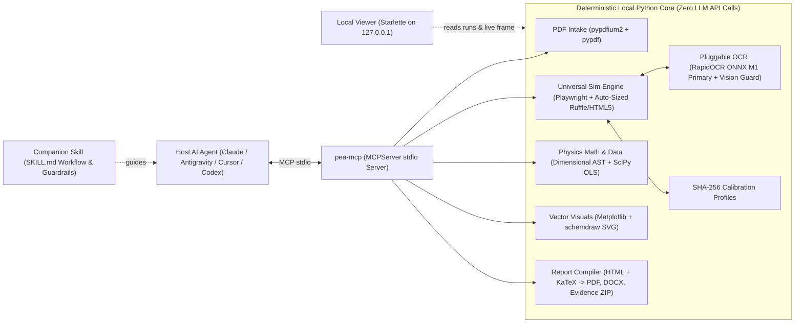

# PEA v2 — Master Implementation Plan & Progress Tracker

> **Current Status:** `Phase 2C Complete — Ready for Phase 2D`
> **Last Updated:** `2026-11-21`
> **Phase Runbooks:** [`PHASE_0_PLAN.md`](./PHASE_0_PLAN.md) · [`PHASE_1_PLAN.md`](./PHASE_1_PLAN.md) · [`PHASE_2_PLAN.md`](./PHASE_2_PLAN.md)

This document is the single source of truth for rebuilding **PEA (Physics Experiments Automation)** into a universal, zero-API-cost MCP server, Agent Skill, Claude Desktop extension (`.mcpb`), and lightweight local viewer. Update the checkboxes and Progress Log below at the end of every phase or milestone.

---

## 1. Locked-In Design Decisions (from `/grill-me`)

| Axis | Decision |
| :--- | :--- |
| **Product Surface** | Agent-first universal **MCP server** (`pea-mcp`) + companion **Agent Skill** (`SKILL.md`) + **Claude Desktop `.mcpb`** bundle + optional lightweight **local Starlette viewer** (`127.0.0.1`). |
| **Cost & AI Policy** | **Strictly zero-API-cost deterministic local software.** PEA makes zero LLM API calls and requires no API keys. Any connecting host agent (Claude Desktop, Antigravity, Cursor, Codex, etc.) supplies multimodal PDF/diagram reading, planning, control calibration, and theory prose. |
| **Universal Experiment Scope** | **Zero hardcoded labs.** M1 delivers Interactive SWF/HTML5 control (`sim_open`, `sim_observe`, `sim_act`), Grid Sweep (`sim_sweep`), Closed-Loop Extremum/Plateau Search (`sim_search_extremum`), Bench-Data Ingest (`data_ingest`), and SHA-256 Calibration Profiles. M2 extends with Timed Transient Watch (`sim_watch`, e.g., Lab 3) and Sandboxed Numerical Compute (`compute_sim`). |
| **Sandboxing & Security** | Loopback-only (`127.0.0.1`) by default for local `.swf` and HTML5 files; external HTML5 simulator domains require an explicit `PEA_ALLOWED_ORIGINS` allowlist. Ruffle runs with `allowScriptAccess: false` and `allowNetworking: 'none'`. Playwright blocks external network routes unless allowlisted. |
| **Reports & Provenance** | Clean university submission layout by default with modular opt-in sections (**Self-Control Q&A**, **Additional Problems**). Compiled via **HTML + offline KaTeX + inline SVGs + Noto Sans → Playwright Chromium A4 PDF**, plus optional editable **`.docx`** (`python-docx`), separate **`evidence.zip`**, and optional **Teacher Evidence Packet PDF**. |
| **Tech Stack** | Pure Python (`pyproject.toml` + `.venv`, **Python `3.13`** via permanent uv-managed toolchain — verified arm64 wheels for all 17 deps since `onnxruntime` lacks Python `3.14` wheels): official `mcp` (`MCPServer`) SDK, `playwright`, `numpy`, `scipy`, `matplotlib`, `schemdraw`, `pypdfium2`, `pypdf`, `python-docx`, `pillow`, `starlette`, `uvicorn`, `pydantic`, plus **`RapidOcrBackend` (`rapidocr` + `onnxruntime` using `ch_PP-OCRv5_det_mobile.onnx` + `cyrillic_PP-OCRv5_rec_mobile.onnx`) promoted & verified 100% in M1** behind a pluggable `OcrBackend` protocol (with optional timeout-guarded macOS Vision Swift helper, following the Phase 0 macOS `27.2` Vision `.accurate` hang discovery). |
| **Git & Legacy Migration** | Safely copy the existing workspace to `../PEA-legacy-backup/`, harvest reusable assets (Ruffle `0.7.1`, Noto Sans fonts, local SWFs) into gitignored `local_assets/`, initialize a clean **orphan `main` branch** (preserving `PLAN_V2.md`, `PHASE_0_PLAN.md`, and `PHASE_1_PLAN.md`) with a strict `.gitignore`. **Never force-push to `origin` without explicit user instruction.** |

---

## 2. System Architecture



### Target Repository Layout (Clean Orphan `main`)

```text
PEA/
├── .gitignore                        # Ignores .venv/, runs/, local_assets/, dist/, profiles/local/, *.swf, *.pdf, *.docx, *.zip
├── PLAN_V2.md                        # Master blueprint & progress tracker (preserved across orphan init)
├── PHASE_0_PLAN.md                   # Day-0 non-destructive Ruffle probe plan & findings
├── PHASE_1_PLAN.md                   # Phase 1 clean-slate migration, .venv & core contracts runbook
├── PHASE_2_PLAN.md                   # Phase 2 core subsystems (2A-2D) implementation runbook
├── pyproject.toml                    # Unified Python package, dependencies, pea-mcp & pea-viewer entry points
├── README.md                         # Setup, MCP client configs, architecture, zero-API-cost policy
├── scripts/
│   ├── fetch_assets.py               # Populates local_assets/ (Ruffle 0.7.1, offline KaTeX, Noto Sans)
│   └── build_mcpb.py                 # Builds unsigned Claude Desktop .mcpb bundle into dist/
├── native/
│   └── macos_vision_ocr.swift        # Persistent JSON-lines over stdio Vision OCR daemon
├── src/pea/
│   ├── __init__.py
│   ├── config.py                     # Paths, allowlisted HTML5 origins, loopback security settings
│   ├── schemas.py                    # Shared Pydantic v2 contracts (M1 + M2-ready interfaces)
│   ├── workspace.py                  # Run directories, SHA-256 provenance ledger, atomic status writes
│   ├── pdf_intake.py                 # lab_inspect_pdf: renders pages to PNG + extracts text/tables
│   ├── ocr/
│   │   ├── __init__.py
│   │   ├── base.py                   # OcrBackend protocol (cross-platform seam)
│   │   ├── rapid_ocr.py              # M1 primary ONNX Runtime OCR (Cyrillic + Latin/digits)
│   │   └── macos_vision.py           # Optional timeout-guarded Swift Vision backend
│   ├── sim/
│   │   ├── __init__.py
│   │   ├── swf_meta.py               # Parses CWS/FWS header for exact native (W, H), FPS, SHA-256
│   │   ├── profiles.py               # Load/save/validate SHA-256 keyed Calibration Profiles
│   │   ├── runtime_server.py         # Loopback-only HTTP server for Ruffle & local HTML5 sims
│   │   ├── engine.py                 # Playwright session manager: open, observe, act, sweep, search_extremum
│   │   └── protocols_m2.py           # M2 interface stubs (sim_watch, compute_sim)
│   ├── math_engine/
│   │   ├── __init__.py
│   │   ├── calculator.py             # Safe 5-dim SI AST evaluator (mechanics + electrical/AC + complex + vectors)
│   │   └── analysis.py               # Bench/sim ingest, safe column formulas, free/zero-intercept OLS, % dev
│   ├── visuals/
│   │   ├── __init__.py
│   │   ├── plots.py                  # Matplotlib vector SVG + 300 DPI PNG plots
│   │   └── diagrams.py               # schemdraw circuit schematics & parametric phasor/wave SVGs
│   ├── report/
│   │   ├── __init__.py
│   │   ├── templates/                # Academic EN/RU HTML+CSS+offline-KaTeX templates
│   │   ├── pdf_builder.py            # ReportSpec -> Playwright Chromium A4 PDF + page PNG previews
│   │   ├── docx_builder.py           # ReportSpec -> editable .docx via python-docx
│   │   └── evidence.py               # Raw evidence.zip + optional Teacher Evidence Packet PDF
│   ├── viewer/
│   │   ├── __init__.py
│   │   ├── app.py                    # Lightweight Starlette loopback viewer
│   │   └── static/                   # Minimal clean dashboard UI
│   └── mcp_server.py                 # MCPServer stdio server registering 16 universal tools + pea://policy
├── skills/
│   └── pea-lab-assistant/
│       └── SKILL.md                  # Universal workflow & guardrails for any connecting agent
├── packaging/
│   └── mcpb/
│       ├── manifest.json             # Claude Desktop Extension manifest (v0.3)
│       └── launcher.mjs              # Tiny zero-dep Node shim launching project .venv/bin/pea-mcp
├── tests/
│   ├── test_swf_meta.py
│   ├── test_calculator.py
│   ├── test_analysis.py
│   ├── test_visuals.py
│   ├── test_pdf_intake.py
│   ├── test_report_builders.py
│   ├── test_ocr_and_profiles.py
│   ├── test_mcp_protocol.py
│   └── e2e/
│       ├── test_lab4_e2e.py          # Real Ruffle SWF grid sweep benchmark (m96210 + m96211)
│       └── test_lab5_e2e.py          # Real Ruffle SWF plateau search benchmark (m96220)
├── local_assets/                     # [GITIGNORED] ruffle/, katex/, fonts/, ocr/, sims/ (m96210, m96211, m96220)
└── runs/                             # [GITIGNORED] Per-run screenshots, OCR logs, reports, evidence ZIPs
```

---

## 3. Master Execution Checklist

### Phase 0 — Day-0 Go/No-Go Gate (`m96220.swf` in Ruffle `0.7.1`)
> Detailed execution steps and full findings live in [`PHASE_0_PLAN.md`](./PHASE_0_PLAN.md). **Gate Closed: `GO WITH VERIFIED MITIGATION` (2026-11-20).**
- [x] **0.1** Stage isolated scratch loopback harness with `m96220.swf` (`800×600` stage) and existing Ruffle `0.7.1`
- [x] **0.2** Boot headless Chromium, lock player bounds `(0, 39, 800, 600)`, capture baseline screenshot & OCR map
- [x] **0.3** Visually inventory all `m96220.swf` controls (`L`, `C`, `R`, `ω`, switches) and readouts ($U_{0C}/\varepsilon_0$)
- [x] **0.4** Execute live stepper-commit edits for Team 2 ($L=5.0\text{ mH}, C=32\text{ µF}, R \in \{3.2, 4.0, 5.0, 6.0\}\,\Omega$) and verify resonance plateaus & RapidOCR extraction (`50/50` Lab 5 + `12/12` R=4/5/6 boundaries + `72/72` legacy Lab 4)
- [x] **0.5** Record Go/No-Go gate decision & findings in `PHASE_0_PLAN.md`

### Phase 1 — Clean-Slate Migration, `.venv` & Core Contracts
> Detailed execution steps and verification results live in [`PHASE_1_PLAN.md`](./PHASE_1_PLAN.md). **Complete (`2026-11-21`).**
- [x] **1.1** Back up entire existing repo outside workspace to `../PEA-legacy-backup/` and verify backup integrity
- [x] **1.2** Stage reusable local assets (Ruffle `0.7.1`, Noto Sans Regular/Bold, `m96210.swf`, `m96211.swf`, `m96220.swf`) in a temporary holding path outside git
- [x] **1.3** Initialize fresh orphan `main` branch locally (preserving `PLAN_V2.md`, `PHASE_0_PLAN.md`, and `PHASE_1_PLAN.md`; **no remote force-push**)
- [x] **1.4** Create strict `.gitignore` and move harvested assets into gitignored `local_assets/`
- [x] **1.5** Write `pyproject.toml` and create `.venv` using permanent uv-managed **Python `3.13`** (`~/.local/share/uv/python/cpython-3.13-macos-aarch64-none/bin/python3.13` — NOT Python `3.14` since `onnxruntime` lacks 3.14 wheels, and NOT ephemeral `~/.local/bin/python3.12` -> `/private/tmp/...`); install all deps (`rapidocr`, `onnxruntime`, Playwright Chromium, `pytest`, `ruff`)
- [x] **1.6** Implement `scripts/fetch_assets.py` (offline KaTeX CSS/JS/fonts into `local_assets/katex/` + pinned RapidOCR ONNX models `ch_PP-OCRv5_det_mobile.onnx` & `cyrillic_PP-OCRv5_rec_mobile.onnx` into `local_assets/ocr/`)
- [x] **1.7** Implement `src/pea/config.py`, `src/pea/schemas.py` (all M1 + M2-ready Pydantic v2 contracts), and `src/pea/workspace.py` (run dirs, SHA-256 provenance ledger, atomic status writes)

> Detailed execution steps for Phases 2A–2D live in [`PHASE_2_PLAN.md`](./PHASE_2_PLAN.md).

### Phase 2A — Pluggable OCR Engine (`RapidOCR` M1 Primary + Vision Guard) & Universal Simulator Engine
- [x] **2A.1** Implement `src/pea/ocr/base.py` (`OcrBackend` protocol) and `src/pea/ocr/rapid_ocr.py` (`RapidOcrBackend` via ONNX Runtime with `ch_PP-OCRv5_det_mobile` + `cyrillic_PP-OCRv5_rec_mobile`, `use_cls=False`, `intra_op_num_threads=4`, tight single-line `use_det=False` fast path + padded panel `det+rec`, and Cyrillic↔Latin homoglyph normalization for unit parsing)
- [x] **2A.2** Implement optional `native/macos_vision_ocr.swift` + `src/pea/ocr/macos_vision.py` (compiled with `-module-cache-path local_assets/swift-cache`, hard per-call timeout + automatic fallback to `RapidOcrBackend` so Vision `.accurate` hangs can never stall runs)
- [x] **2A.3** Implement `src/pea/sim/swf_meta.py` (CWS/FWS header parser -> exact native `(W, H)`, FPS, SHA-256)
- [x] **2A.4** Implement `src/pea/sim/runtime_server.py` (loopback `127.0.0.1` HTTP server, `Host` guard, auto-sized Ruffle player, `allowScriptAccess: false`, `allowNetworking: 'none'`)
- [x] **2A.5** Implement `src/pea/sim/profiles.py` (SHA-256 keyed `CalibrationProfile` persistence + live verification)
- [x] **2A.6** Implement `src/pea/sim/engine.py`:
  - [x] `sim_open` / `sim_close` (origin allowlist check, auto-detect saved profile)
  - [x] `sim_observe` (raw hashed PNG + optional annotated OCR coordinate overlay)
  - [x] `sim_act` (click, double-click, drag, type, OS-aware select-all, profile-declared `set_stepper` supporting `enter` and `step_interior` commit modes + inert focus-blur before capture to dismiss carets `|`)
  - [x] `sim_sweep` (high-speed N-point grid runner, homoglyph-normalized unit-aware OCR parser `мкТл`/`мТл`, optional sign `[-−]?\d+`, control match assertions, clean cancel with partial evidence)
  - [x] `sim_search_extremum` (`max`, `min`, wide-plateau `plateau_max` `[ω1, ω2]` detection handling plateaus ≥80 steps such as $R=5.0\,\Omega$'s 74-step plateau, `threshold`, full step trace + boundary screenshots)
- [x] **2A.7** Define clean M2 stubs in `src/pea/sim/protocols_m2.py` (`sim_watch`, `compute_sim`)

### Phase 2B — Physics Math, Data Analysis & Vector Visuals
- [x] **2B.1** Implement `src/pea/math_engine/calculator.py` (5-dim SI `[kg, m, s, A, K]`, mechanics + electrical/AC units, 3D vectors, complex impedance, immutable `calc_id` ledger, zero `eval`/`exec`)
- [x] **2B.2** Implement `src/pea/math_engine/analysis.py` (`data_ingest` CSV/JSON/sim, `data_analyze` safe column transforms, explicit `free`/`zero` intercept OLS, slope SE, $R^2$, % deviation)
- [x] **2B.3** Implement `src/pea/visuals/plots.py` (Matplotlib vector `.svg` + 300 DPI `.png`: linearized regressions with fit equations, resonance curves, error bars, AC waveforms, $q$–$I$ phase portraits)
- [x] **2B.4** Implement `src/pea/visuals/diagrams.py` (`schemdraw` circuit schematics with LaTeX labels + parametric phasor/impedance/field SVGs)

### Phase 2C — PDF Intake & Submission-Ready Report Compiler
- [x] **2C.1** Implement `src/pea/pdf_intake.py` (`lab_inspect_pdf` via `pypdfium2` page PNGs + `pypdf` text extraction)
- [x] **2C.2** Build EN/RU academic templates (`src/pea/report/templates/`) with offline KaTeX, Noto Sans fonts, modular opt-in Q&A and Additional Problems sections
- [x] **2C.3** Implement `src/pea/report/pdf_builder.py` (Playwright Chromium A4 PDF + `report_preview` PNG rendering)
- [x] **2C.4** Implement `src/pea/report/docx_builder.py` (editable `.docx` via `python-docx` with tables and 300 DPI figures)
- [x] **2C.5** Implement `src/pea/report/evidence.py` (`evidence.zip` with raw screenshots, `provenance.jsonl`, OCR logs, CSV/JSON + optional multi-page `teacher-evidence.pdf`)

### Phase 2D — MCP Server, Local Viewer, Agent Skill & `.mcpb`
- [ ] **2D.1** Implement `src/pea/mcp_server.py` (`MCPServer` stdio server registering all **16 universal tools** + `pea://policy` resource, Pydantic validation, path confinement)
- [ ] **2D.2** Implement `src/pea/viewer/app.py` + `static/` (Starlette loopback `127.0.0.1:5190`, `Host`/`Origin` guards, live capture feed, OCR box toggle, run history, downloads)
- [ ] **2D.3** Author `skills/pea-lab-assistant/SKILL.md` (strict zero-fabrication, calibration, `calc_eval`/`data_analyze` math, visual PDF QA workflow)
- [ ] **2D.4** Create `packaging/mcpb/manifest.json`, `packaging/mcpb/launcher.mjs`, `scripts/build_mcpb.py`, and `README.md`

### Phase 3 — Automated Verification & Live Dual-Lab Benchmarks
- [ ] **3.1** Unit & protocol test suite (`pytest tests/ -m "not live_sim" -v` + `ruff check src/ tests/`)
- [ ] **3.2** **Lab 5 Live E2E Benchmark (`test_lab5_e2e.py`):** `m96220.swf`, Team 2 ($L=5.0\text{ mH}, C=32\text{ µF}$), `plateau_max` across $R \in \{3.2, 4.0, 5.0, 6.0\}\,\Omega$, Table 2, $\omega_0/\Delta\omega$ vs $Q^2$ plot & $4Q^2$ check, redrawn Fig. 1 schematic, Problem 4C $q$–$I$ ellipse + worked sample Q&A/problems, PDF + DOCX + `evidence.zip`, full page visual inspection
- [ ] **3.3** **Lab 4 Live E2E Benchmark (`test_lab4_e2e.py`):** Same generic tools on `m96210.swf` + `m96211.swf`, Team 2 (72 readings), 72/72 readout match check, handout-compliant Tables 2–3 (transformed rows), linearized $1/r$ & $(R^2+r^2)^{-3/2}$ plots, slopes & $\mu_0$ % deviations, PDF + DOCX + `evidence.zip`, full page visual inspection
- [ ] **3.4** Build `dist/pea-mcp-0.2.0.mcpb`, audit ZIP contents (zero SWFs/handouts/secrets), and verify local Starlette viewer on desktop (`1280px`) and mobile (`390px`) viewports

### Milestone 2 Backlog (Deferred After M1)
- [ ] **M2.1** `sim_watch`: Frame-timestamped transient/stopwatch capture (supports Lab 3 RC discharge & time-domain sims)
- [ ] **M2.2** `compute_sim`: Sandboxed NumPy/SciPy numerical/ODE modeling explicitly tagged `model_computed`
- [x] **M2.3** ~~Cross-platform `RapidOcrBackend` (ONNX Runtime) fallback~~ → **Promoted to M1 (`Phase 2A.1`)** following Phase 0 macOS `27.2` Vision `.accurate` hang discovery.

---

## 4. Known Engineering Pitfalls & Guardrails

1. **macOS Vision OCR Hang on macOS `27.2` & RapidOCR Model/Crop/State Rules:** Phase 0 verified that `VNRecognizeTextRequest` `.accurate` hangs indefinitely (`>12 s` / `>30 s`) on macOS `27.2` (`Build 26B123`) across all revisions (`1–3`), CPU/GPU/ANE, `CGImage`/`URL`, modern `RecognizeTextRequest`, and `NSApplication.shared` (and fails with `nilError` inside sandbox), while `.fast` has `has_ru = false` across all revisions and drops `2444` (Team 2 $R=4.0\,\Omega$ upper plateau edge!). Use `RapidOcrBackend` (`ch_PP-OCRv5_det_mobile.onnx` + `cyrillic_PP-OCRv5_rec_mobile.onnx`, pinned offline in `local_assets/ocr/` — never default `LangRec.CH` which drops Russian headers!), running tight single-line ROIs in `use_det=False` rec-only mode (`17 ms/crop`) or padded panel ROIs in `det+rec` mode (`~300 ms/crop`, avoiding unpadded wide strips). **Stateful API trap (`rapidocr==3.10.0`):** passing `use_det=False` mutates `eng.use_det` persistently on the instance, so ALWAYS pass `use_det=True`/`use_det=False` explicitly on every call (verified `72/72` on Lab 4 after a `use_det=False` call). Always guard any optional Vision helper with a hard timeout + `-module-cache-path local_assets/swift-cache`.
2. **Flex `FlaconNumericStepper` Commit Quirks & Boundary Traps:** Two distinct Flex behaviors exist across SWFs: (a) Lab 4 (`m96210`/`m96211`) required a native stepper click (using interior direction `target - step` + `▲` near `max_val` to avoid clamping); (b) Lab 5 (`m96220`) commits immediately on typing (`.` or `,` after `Meta+a` or `Control+a`) + `Enter`, `Tab`, or blur even at min/max bounds (`L = 5.0 mH` is `max_val`), **whereas** typing an out-of-range value + clicking a boundary arrow *without* `Enter` clamps the visual box while leaving physics stale. Always support profile-declared commit modes (`enter`, `step_interior`), blur focus onto an inert coordinate to dismiss blinking carets `|` before OCR (which otherwise OCR as a leading `1`), and verify readback.
3. **Unit-Scale, Homoglyph & Sign-Aware OCR Parsing:** Always normalize Cyrillic↔Latin visual homoglyphs (`m→м`, `k→к`, `t→т`, `l→л`, `c→с`, `o→о`, `h→н`, `p→р`, `x→х`, `a→а`, `e→е`) before parsing physical units (`мкТл` vs `мТл`, `мкФ` vs `пФ`, `Ом`, `мГн`, `с⁻¹`), and always parse optional signs (`[-−]?\d+`) rather than assuming fixed signs or micro-units.
4. **Dynamic SWF Stage Sizing:** Always read stage dimensions from the SWF header (`500×450`, `700×500`, `800×600`, etc.) before rendering `<ruffle-player>` so Flex panels neither clip readouts nor distort coordinates.
5. **Scientific Honesty:** Never fill missing simulator readings from equations; distinguish `simulator_captured`, `bench_manual`, and `model_computed`; retain partial evidence on failure or cancellation; never mark independent manual validation as complete automatically.
6. **Git Hygiene:** Keep `local_assets/`, `runs/`, `.venv/`, `dist/`, and all university `.swf`/`.pdf` artifacts strictly gitignored.

---

## 5. Progress Log

| Date | Phase | Summary | Verification / Evidence |
| :--- | :--- | :--- | :--- |
| 2026-11-20 | Planning | Inspected legacy repo (`magnetic-field-lab`, `lab-runner`, `field-lab-mcp`, `swf-pilot`) and new Lab 5 attachments (`m96220.swf` + RLC PDF); completed `/grill-me` design decisions and created `PLAN_V2.md` & `PHASE_0_PLAN.md`. | Read-only SWF header check verified `m96220.swf` is `800×600 px`, 24 fps, Flex/Flacon SWF v9; no legacy files altered. |
| 2026-11-20 | Phase 0 | Executed non-destructive Day-0 Ruffle `0.7.1` gate on `m96220.swf` and empirically verified the OCR mitigation in `/tmp/pea-phase0-probe/`. **Result: `GO WITH VERIFIED MITIGATION`.** Verified exact `800×600` stage, all controls/bounds/steps/commit modes, `Схема`/`Установка` modes, and all 4 Team 2 Lab 5 plateaus (`R=3.2 → [2445,2472]` midpoint `2458.5` vs `2458.70` `0.008%`; `R=4.0 → [2427,2444]`; `R=5.0 → [2361,2434]` 74-step plateau; `R=6.0 → [2333,2370]`). Confirmed macOS `27.2` Vision `.accurate` hangs across revisions `1–3` and `.fast` lacks `ru-RU` + drops `2444`. Benchmarked `RapidOCR` (`ch_PP-OCRv5_det_mobile` + `cyrillic_PP-OCRv5_rec_mobile` on permanent uv Python `3.13`, since `onnxruntime` lacks `3.14` wheels): **`50/50` (`100%`, `17.4 ms/ROI` rec-only) on Lab 5 sweep, `12/12` on R=4/5/6 boundaries, and `72/72` (`100%`) value+sign+unit match on legacy Lab 4 crops**. | Live Chromium `149.0.7827.55` + Ruffle `0.7.1` (`0` pageErrors, `0` console warn/err, `50` sweep + `12` R=4/5/6 + min/max/mode/commit/tall-container probes); isolated `/tmp/pea-phase0-probe/.venv-ocr` RapidOCR benchmark (`rapidocr==3.10.0`, `onnxruntime==1.32.0`); zero legacy repo files touched. |
| 2026-11-21 | Phase 1 | Backed up legacy repo to `../PEA-legacy-backup/`, harvested Ruffle `0.7.1`, Noto Sans, RapidOCR ONNX models, local SWFs, and benchmark inputs into gitignored `local_assets/`, created clean orphan `main` branch (`12` tracked text files, zero binaries/home paths, no remote push), built Python `3.13.14` `.venv` with all 17 deps, implemented `scripts/fetch_assets.py` (`37` pinned offline files across `katex`, `ocr`, `ruffle`, `fonts`), and froze `config.py`, `schemas.py`, and `workspace.py`. | `32/32` tests pass in `tests/test_phase1_core.py`, `ruff check src/ tests/ scripts/` clean (`0` errors), `scripts/fetch_assets.py --check` passed offline (`37` files), `git rev-list --count HEAD == 1`. |
| 2026-11-21 | Phase 2A | Implemented pluggable offline OCR (`src/pea/ocr/`: `OcrBackend`, `RapidOcrBackend` with explicit per-call `use_det` guard & homoglyph/unit parser, optional timeout-guarded `native/macos_vision_ocr.swift` + `MacOsVisionOcrBackend`) and universal simulator engine (`src/pea/sim/`: FWS/CWS/ZWS `swf_meta.py`, IPv4/IPv6 loopback `Host`-guarded `SimRuntimeServer`, SHA-256 atomic `ProfileStore`, `SimulatorSession`/`SimulatorManager` with boundary-safe `set_stepper`, `sweep`, wide-plateau `search_extremum`, cancellation/failure evidence preservation, and M2 stubs `protocols_m2.py`). | `60/60` offline tests pass (`tests/test_phase1_core.py`, `test_swf_meta.py`, `test_ocr_and_profiles.py`, `test_sim_protocols.py`), `ruff check src/ tests/ scripts/` clean (`0` errors), live headless Chromium + Ruffle `0.7.1` `SimulatorManager.open()` + `observe()` verified on `m96220.swf` & `m96210.swf`, Swift helper compiled cleanly via `-module-cache-path local_assets/swift-cache`, clean local commit on `main` (no remote push). |
| 2026-11-21 | Phase 2B | Implemented safe 5-dim SI dimensional physics calculator (`src/pea/math_engine/calculator.py`: compound/Unicode/Cyrillic units, complex AC impedance, 3D vectors, holomorphic complex + vector forward-mode Gaussian uncertainty propagation, lock-guarded append-only `calculations.jsonl` ledger, zero `eval`/`exec`), tabular data ingest + safe AST transforms + scale-invariant free/zero-intercept OLS regression (`src/pea/math_engine/analysis.py`), and vector visuals (`src/pea/visuals/plots.py` with bundled Noto Sans EN+Cyrillic, `equal_aspect`, legend/annotation collision avoidance; `src/pea/visuals/diagrams.py` with `schemdraw==0.23` circuit schematics including `.to()` orientation fix for `Source`/`Meter` subclasses + parametric phasor/waveform/field SVG+300 DPI PNG export, atomic writes, and provenance-safe overwrite guards). | `108/108` offline tests pass (`.venv/bin/pytest tests/ -m "not live_sim" -v`, adding `test_calculator.py`, `test_analysis.py`, `test_visuals.py`), `.venv/bin/ruff check src/ tests/ scripts/` clean (`0` errors), real Lab 4 benchmark wire data recovers $\mu_0$ within `0.053%`, visual PNG inspection verified Cyrillic/LaTeX plots & branched Lab 5 parallel-voltmeter `schemdraw` schematic, clean local commits on `main` (no remote push). |
| 2026-11-21 | Phase 2C | Implemented offline PDF handout intake (`src/pea/pdf_intake.py` via `pypdfium2` + `pypdf` with atomic PNG renders, `extracted-text.json`, and provenance immutability guards) and submission-ready report compiler (`src/pea/report/`: academic EN/RU HTML+CSS+offline-KaTeX+Noto-Sans templates, ephemeral loopback-only `_OfflineRenderServer` + strict zero-external-network Playwright Chromium A4 PDF exporter & `preview_report_pages` in `pdf_builder.py`, editable `python-docx` mirror in `docx_builder.py`, raw `evidence.zip` packager + optional multi-page `teacher-evidence.pdf` audit packet in `evidence.py`, and unified `build_report` orchestrator in `__init__.py`). | `118/118` offline tests pass (`.venv/bin/pytest tests/ -m "not live_sim" -v`, adding `test_pdf_intake.py` and `test_report_builders.py`), `.venv/bin/ruff check src/ tests/ scripts/` clean (`0` errors), 8-page `lab5-rlc-handout.pdf` intake verified, EN/RU/Teacher PDF preview PNGs visually inspected (fixing provenance column wrapping & compact table pagination), external network blocking & symlink/`.tmp` exclusions verified, clean local commit on `main` (no remote push). |
