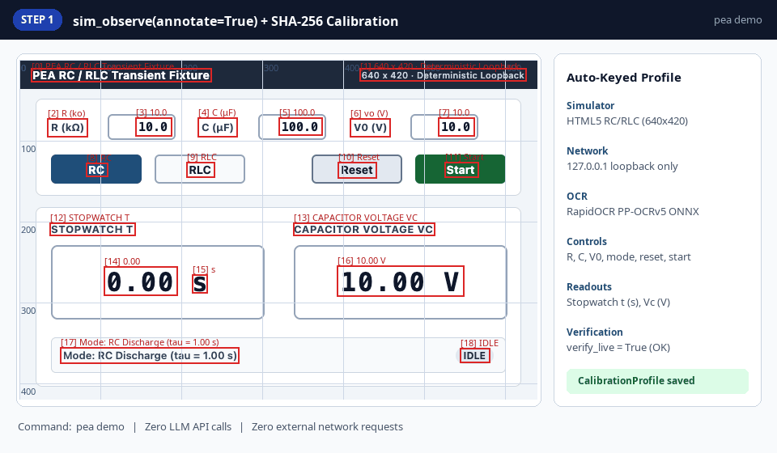
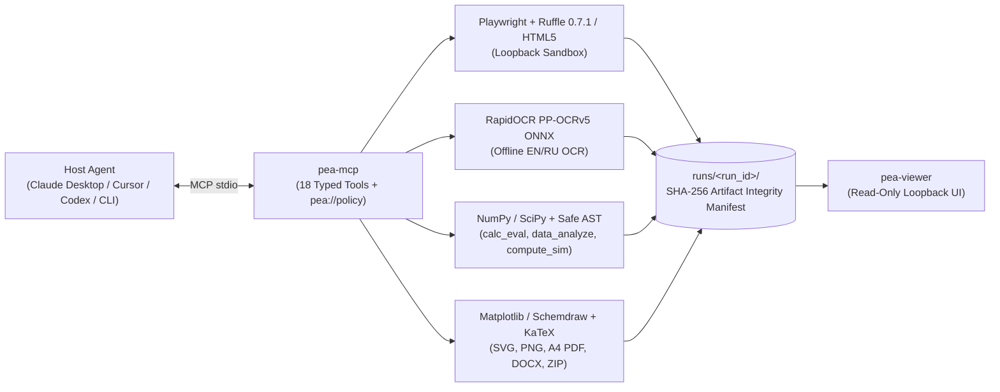
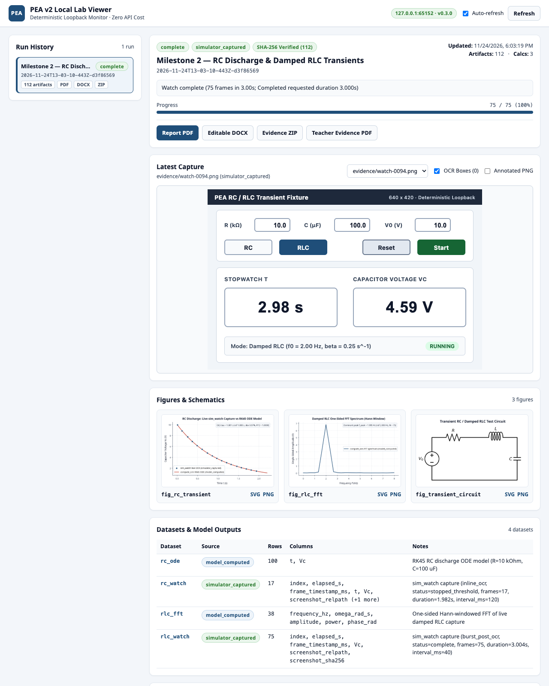
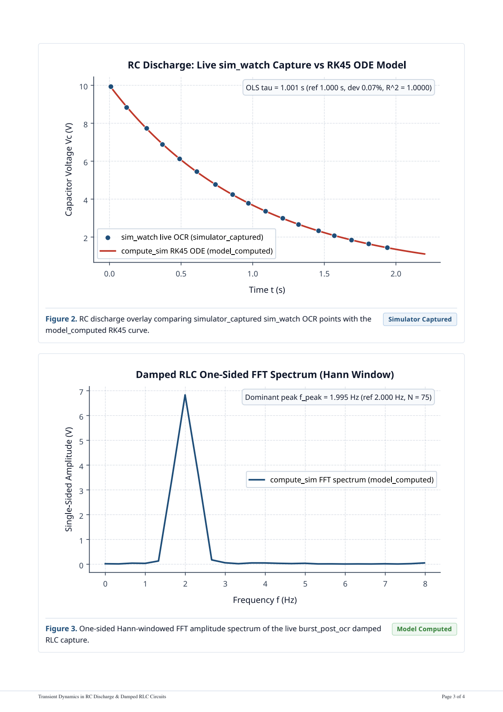

# PEA v2 — Physics Experiments Automation

[](https://github.com/Mottii/PEA/actions/workflows/ci.yml)
[](./LICENSE)
[](./pyproject.toml)
[](#universal-mcp-surface-18-tools--peapolicy)
[](#security--scientific-integrity-defaults)

**Point your AI agent at a legacy Flash (`.swf`) or HTML5 physics lab simulator and get a SHA-256-verified dataset, deterministic physics math, vector plots, and an auditable lab report draft—locally, with zero LLM API cost.**

**PEA (Physics Experiments Automation)** exposes 18 typed tools over **MCP stdio** (`pea-mcp`), a companion **Agent Skill** ([`skills/pea-lab-assistant/SKILL.md`](./skills/pea-lab-assistant/SKILL.md)), a **Claude Desktop extension (`.mcpb`)**, and a read-only **loopback viewer** (`pea-viewer`). PEA makes **zero LLM API calls** and requires **no API keys**: your host agent (Claude Desktop, Cursor, Antigravity, Codex, etc.) supplies handout reading, experiment planning, and scientific prose, while PEA executes deterministic Playwright + Ruffle `0.7.1` simulator interaction, offline EN/RU ONNX OCR, dimensional physics math, OLS regressions, sandboxed ODE/FFT modeling, vector plots/schematics, and structured report compilation.



---

## Architecture



---

## Visual Showcase (Self-Contained Open-Source Benchmark)

All visuals below are generated directly from the open-source [`tests/fixtures/html5_rc_sim`](./tests/fixtures/html5_rc_sim/index.html) RC discharge & damped RLC transient benchmark (`v0.3.1`, SHA-256 integrity-checked artifacts, zero external network requests).

### Local Run & Datasets Viewer (`pea-viewer`)



### Compiled Academic Report Plots (Live `sim_watch` vs Sandboxed `compute_sim`)



---

## Security & Scientific Integrity Defaults

- **Zero API Cost:** Strictly zero paid AI/LLM API calls and zero API keys required.
- **Loopback-Only by Default (`127.0.0.1`):** Local SWF and HTML5 simulators run on loopback with Ruffle `allowScriptAccess: false` and `allowNetworking: "none"`. External HTML5 simulator domains are blocked unless explicitly allowlisted via `PEA_ALLOWED_ORIGINS`.
- **Zero Arbitrary Shell / Filesystem Tools:** `pea-mcp` exposes only 18 typed domain tools plus the read-only `pea://policy` resource. All schemas enforce `extra="forbid"` (`additionalProperties: false`), and all file inputs/outputs are strictly confined to project/run roots (rejecting `..` traversal and symlink escapes).
- **Zero-`eval`/`exec` Math & ODE Sandbox:** `calc_eval`, `data_analyze`, and `compute_sim` evaluate expressions strictly via an allowlisted AST evaluator with depth, length, exponent, `max_nfev`, and monotonic `timeout_s` resource guards.
- **Read-Only Hardened Viewer:** `pea-viewer` binds strictly to loopback (`127.0.0.1:5190`), enforces anti-DNS-rebinding `Host` and same-origin `Origin` checks, rejects non-`GET`/`HEAD` methods, serves strict CSP + `X-Content-Type-Options: nosniff`, and confines `/runs/{run_id}/{artifact}` reads.
- **Scientific Honesty & Provenance Separation:** Datasets, tables, and figures explicitly distinguish `simulator_captured`, `bench_manual`, and `model_computed` sources. Missing simulator readings are never back-filled from equations, and partial evidence is preserved on failure or cancellation.
- **SHA-256 Artifact Integrity Manifest (`provenance.jsonl`):** Per-artifact SHA-256 hashes verify that files on disk match their recorded manifest entries—detecting accidental corruption, stale artifacts, or drift during analysis. Because the manifest lives on the local filesystem, it is an integrity and reproducibility check rather than cryptographic tamper-proofing against the machine owner.

See [`SECURITY.md`](./SECURITY.md) for the full threat model and vulnerability reporting policy.

---

## Academic Integrity & Intended Use

PEA is designed for **reproducible data acquisition, auditable calculations, and structured report drafting**—not automating homework.

- **Evidence over fabrication:** Every measurement row is tagged `simulator_captured`, `bench_manual`, or `model_computed`, and failed OCR points are preserved as gaps rather than back-filled from equations.
- **Instructor Verification Packet:** `report_build` can bundle `evidence.zip` and `teacher-evidence.pdf` (*Instructor Audit PDF* in `pea-viewer`) alongside raw frame captures, calibration profiles, calculation logs, and the SHA-256 artifact integrity manifest so instructors or TAs can audit how data was collected.
- **Human authorship:** Students and researchers remain responsible for verifying physical interpretations, writing their own theory and conclusions, and complying with course or institutional policies.

---

## Quick Start (Python 3.12–3.13)

> **Runtime requirement:** Use Python `3.12` or `3.13` (`requires-python = ">=3.12,<3.14"`). Python `3.14` currently lacks prebuilt binary wheels for `onnxruntime` on several platforms.

### macOS / Linux

```sh
# 1. Create a virtual environment (uv recommended; or: python3 -m venv .venv)
uv venv .venv --python 3.13

# 2. Install PEA v2 in editable mode with dev tooling
uv pip install --python .venv/bin/python -e ".[dev]"

# 3. Fetch & verify pinned offline assets (KaTeX, RapidOCR ONNX, Ruffle 0.7.1, Noto Sans)
#    and install Playwright Chromium in one command (add --with-deps on Linux)
.venv/bin/pea setup

# 4. Run the offline verification suite, linter, and .mcpb packaging audit
.venv/bin/pytest tests/ -m "not live_sim" -v
.venv/bin/ruff check src/ tests/ scripts/
.venv/bin/python scripts/build_mcpb.py --check
```

*(Note: PEA also decouples user cache paths via `pea.config.default_cache_dir()` so once `pea-mcp` is published on PyPI it can be bootstrapped directly with `uvx pea-mcp setup` and invoked via `uvx pea-mcp`.)*

### Windows (PowerShell)

```powershell
uv venv .venv --python 3.13
.\.venv\Scripts\Activate.ps1
uv pip install --python .venv\Scripts\python.exe -e ".[dev]"
.venv\Scripts\pea.exe setup
.venv\Scripts\pytest.exe tests\ -m "not live_sim" -v
```

---

## 60-Second Self-Contained Demo

Run the complete live HTML5 RC discharge & damped RLC transient pipeline (headless Chromium + RapidOCR + `sim_watch` + `compute_sim` RK45/FFT + Matplotlib/Schemdraw + A4 PDF/DOCX/ZIP + SHA-256 verification) and open `pea-viewer` in one command—no external handouts or Flash binaries required:

```sh
.venv/bin/pea demo
```

Optional flags:
- `--out runs/demo` — choose where demo runs and profiles are written (default: `runs/demo`).
- `--no-viewer` — run the pipeline headlessly and print the summary without starting `pea-viewer`.
- `--no-browser` — start `pea-viewer` at `http://127.0.0.1:5190` without auto-opening a browser tab.

---

## Connecting MCP Clients (`pea-mcp`)

### Option A — Claude Desktop Extension (`.mcpb`)

Download `pea-mcp-0.3.1.mcpb` from [GitHub Releases](https://github.com/Mottii/PEA/releases) (or build and audit it locally — requires Node.js `>=18` for the zero-dependency stdio launcher):

```sh
.venv/bin/python scripts/build_mcpb.py
# Produces audited dist/pea-mcp-0.3.1.mcpb (~10 KB, zero binaries/SWFs/PDFs/secrets)
```

Install `dist/pea-mcp-0.3.1.mcpb` in Claude Desktop and set **PEA Project Folder** to your local PEA checkout path (containing `.venv/` and `local_assets/`).

### Option B — Standard MCP `stdio` JSON Config (Claude Desktop / Cursor / Antigravity / Codex)

Replace `<PATH_TO_PEA>` with your local checkout path (on Windows, use `<PATH_TO_PEA>\.venv\Scripts\pea-mcp.exe`):

```json
{
  "mcpServers": {
    "pea": {
      "command": "<PATH_TO_PEA>/.venv/bin/pea-mcp",
      "args": [],
      "env": {
        "PEA_PROJECT_ROOT": "<PATH_TO_PEA>",
        "PEA_OCR_BACKEND": "rapidocr"
      }
    }
  }
}
```

### Companion Agent Skill

Point your agent to [`skills/pea-lab-assistant/SKILL.md`](./skills/pea-lab-assistant/SKILL.md) to enforce the full 8-stage workflow (PDF intake → user confirmation → SHA-256 calibration → verified sweep/plateau/transient capture → `calc_eval`/`data_analyze`/`compute_sim` math → vector visuals → structured PDF/DOCX compilation → visual page QA via `report_preview`).

---

## Local Run & Capture Viewer (`pea-viewer`)

Start the lightweight Starlette viewer on loopback (`http://127.0.0.1:5190`):

```sh
.venv/bin/pea viewer
# Or with an explicit runs directory and custom loopback port:
.venv/bin/pea-viewer --runs-dir runs/demo/runs --host 127.0.0.1 --port 5190
```

Features:
- Responsive desktop (`1280px`) and mobile (`390px`) layout with zero external CDN requests.
- Latest capture preview with interactive **OCR Box Overlay** toggle and annotated PNG toggle.
- **Datasets & Model Outputs** table displaying `simulator_captured`, `bench_manual`, and `model_computed` provenance pills, row counts, columns, notes, and JSON download links.
- Live **SHA-256 Artifact Integrity** badge and `provenance.jsonl` manifest inspection.
- One-click downloads for compiled **Report PDF**, **Editable DOCX**, **Evidence ZIP**, and **Instructor Audit PDF** (`teacher-evidence.pdf`).

---

## Universal MCP Surface (`18` Tools + `pea://policy`)

| Category | Name | Description |
| :--- | :--- | :--- |
| **Policy** | `pea://policy` *(resource)* | Read-only JSON runtime security, OCR, and scientific integrity policy |
| **Handout & Runs** | `lab_inspect_pdf` | Render PDF handout pages (`pypdfium2`) + extract text (`pypdf`) |
| **Handout & Runs** | `lab_runs` | `list`, `get`, `create`, or `verify` run workspaces & SHA-256 integrity manifests |
| **Simulator** | `sim_open` | Open local `.swf` (Ruffle), local HTML5 dir, or allowlisted URL |
| **Simulator** | `sim_observe` | Capture raw hashed PNG, run offline OCR, optional annotated grid overlay |
| **Simulator** | `sim_act` | Click, double-click, drag, type, key, wait, blur, or `set_stepper` |
| **Simulator** | `sim_save_profile` | Live-verify and save SHA-256 `CalibrationProfile` |
| **Simulator** | `sim_sweep` | Deterministic N-D parameter grid sweep with OCR verification |
| **Simulator** | `sim_search_extremum` | Closed-loop `max`, `min`, wide `plateau_max`, or `threshold` search |
| **Simulator** | `sim_watch` | Drift-compensated timed transient/stopwatch capture (`burst_post_ocr` or `inline_ocr`) |
| **Simulator** | `sim_close` | Close Playwright session and stop loopback server |
| **Math & Data** | `data_ingest` | Ingest inline rows or confined CSV/JSON preserving `ProvenanceSource` |
| **Math & Data** | `data_analyze` | Safe AST column transforms, free/zero-intercept OLS, % deviations |
| **Math & Data** | `calc_eval` | Safe 5-dim SI dimensional calculator (AC complex, 3D vectors, uncertainties) |
| **Math & Data** | `compute_sim` | Sandboxed zero-eval ODE IVP (`RK45`/`Radau`/`BDF`), algebraic grid, & FFT (`model_computed`) |
| **Visuals** | `plot_render` | Headless Matplotlib vector `.svg` + 300 DPI `.png` plots (Noto Sans EN/RU) |
| **Visuals** | `diagram_render` | `schemdraw` circuit schematics + parametric phasor/waveform/field SVGs |
| **Reports** | `report_build` | Offline HTML+KaTeX → A4 PDF, editable `.docx`, `evidence.zip`, Instructor Audit PDF |
| **Reports** | `report_preview` | Render compiled PDF pages to PNG for mandatory visual QA |

---

## Environment Variables

| Variable | Default | Purpose |
| :--- | :--- | :--- |
| `PEA_PROJECT_ROOT` | Auto-detected source checkout or CWD | Root workspace directory for confinement & default subdirectories |
| `PEA_LOCAL_ASSETS_DIR` | `<project>/local_assets` or user cache | Offline assets (`katex/`, `ocr/`, `ruffle/`, `fonts/`, `sims/`) |
| `PEA_RUNS_DIR` | `<project>/runs` | Per-run evidence, datasets, figures, reports, and integrity manifests |
| `PEA_PROFILES_DIR` | `<project>/profiles` | SHA-256 keyed calibration profiles (`profiles/local/` + shared fallback) |
| `PEA_ALLOWED_ORIGINS` | *(empty — loopback only)* | Comma-separated external HTTP(S) simulator origins |
| `PEA_OCR_BACKEND` | `rapidocr` | Offline OCR backend (`rapidocr` or timeout-guarded `macos_vision`) |
| `PEA_OCR_THREADS` | `4` | ONNX Runtime `intra_op_num_threads` |
| `PEA_OCR_TIMEOUT_S` | `10.0` | Hard per-call timeout for optional Vision OCR helper |
| `PEA_LOOPBACK_HOST` | `127.0.0.1` | Loopback interface (`127.0.0.1`, `localhost`, or `::1`) |
| `PEA_VIEWER_PORT` | `5190` | Local TCP port for `pea-viewer` |
| `PEA_BROWSER` | Cached Playwright Chromium | Optional explicit Chromium executable override |

---

## Documentation, Governance & Architecture Plans

- [`CHANGELOG.md`](./CHANGELOG.md) — Release history (`v0.1.0` – `v0.3.1`).
- [`SECURITY.md`](./SECURITY.md) — Security boundaries and private vulnerability disclosure.
- [`CONTRIBUTING.md`](./CONTRIBUTING.md) — Cross-platform dev setup, test gates, and contribution guidelines.
- [`THIRD_PARTY_NOTICES.md`](./THIRD_PARTY_NOTICES.md) — Attribution for pinned offline assets and runtime dependencies.
- [`LICENSE`](./LICENSE) — MIT License.
- **Architecture & Release Plans ([`docs/plans/`](./docs/plans/)):**
  - [`docs/plans/PLAN_V2.md`](./docs/plans/PLAN_V2.md) — Master architecture blueprint, locked design decisions, checklist, and progress log.
  - [`docs/plans/PHASE_0_PLAN.md`](./docs/plans/PHASE_0_PLAN.md) — Day-0 non-destructive Ruffle `0.7.1` & RapidOCR ONNX verification findings.
  - [`docs/plans/PHASE_1_PLAN.md`](./docs/plans/PHASE_1_PLAN.md) — Clean-slate migration, offline asset pinning, and frozen core contracts.
  - [`docs/plans/PHASE_2_PLAN.md`](./docs/plans/PHASE_2_PLAN.md) — Core subsystems blueprint and verification findings (`2A`–`2D`).
  - [`docs/plans/PHASE_3_PLAN.md`](./docs/plans/PHASE_3_PLAN.md) — Automated verification, live dual-lab E2E benchmarks, visual QA, and `.mcpb` / viewer checks.
  - [`docs/plans/MILESTONE_2_PLAN.md`](./docs/plans/MILESTONE_2_PLAN.md) — Milestone 2 (`sim_watch` timed transients, `compute_sim` sandboxed ODE/FFT engine, `pea-viewer` Datasets view, and `v0.3.0` packaging).
  - [`docs/plans/ADOPTION_AND_POLISH_PLAN.md`](./docs/plans/ADOPTION_AND_POLISH_PLAN.md) — `v0.3.1` onboarding CLI (`pea demo`, `pea setup`), PyPI/`uvx` config decoupling, animated showcase, and framing updates.
